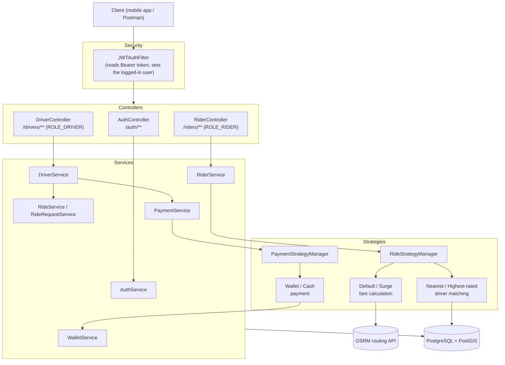
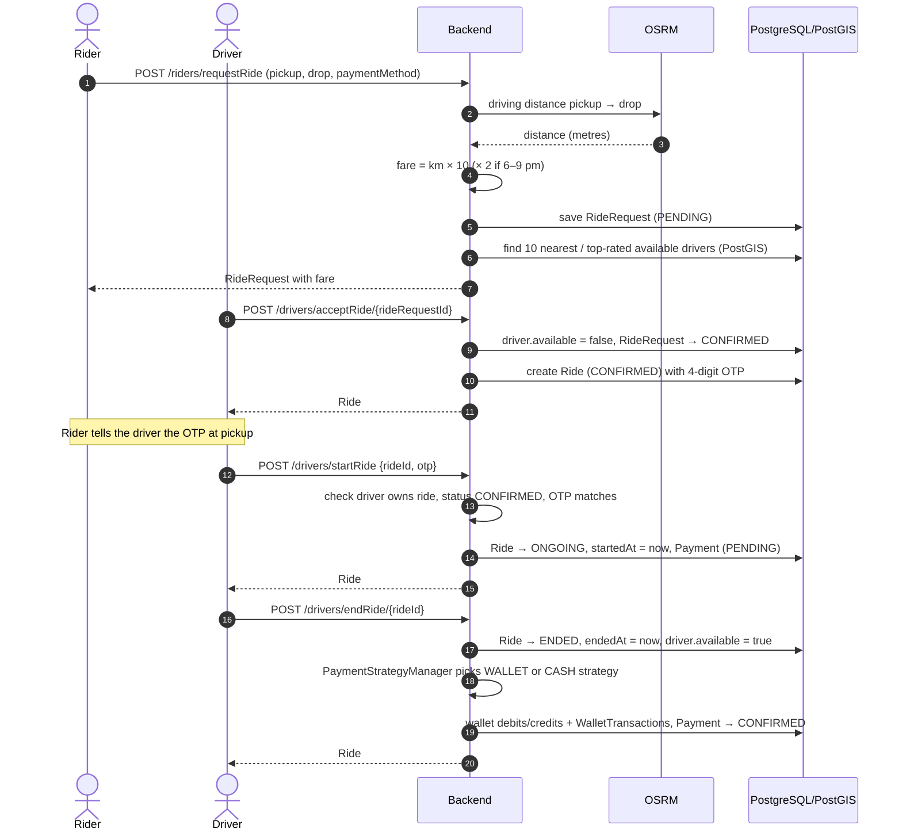
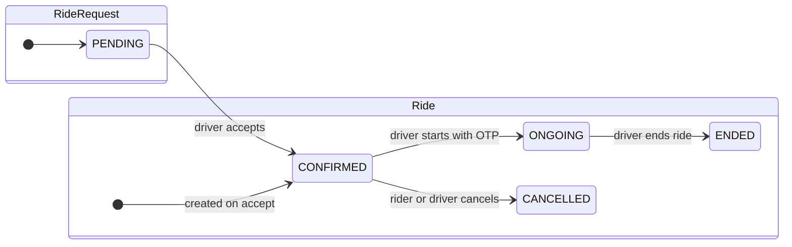
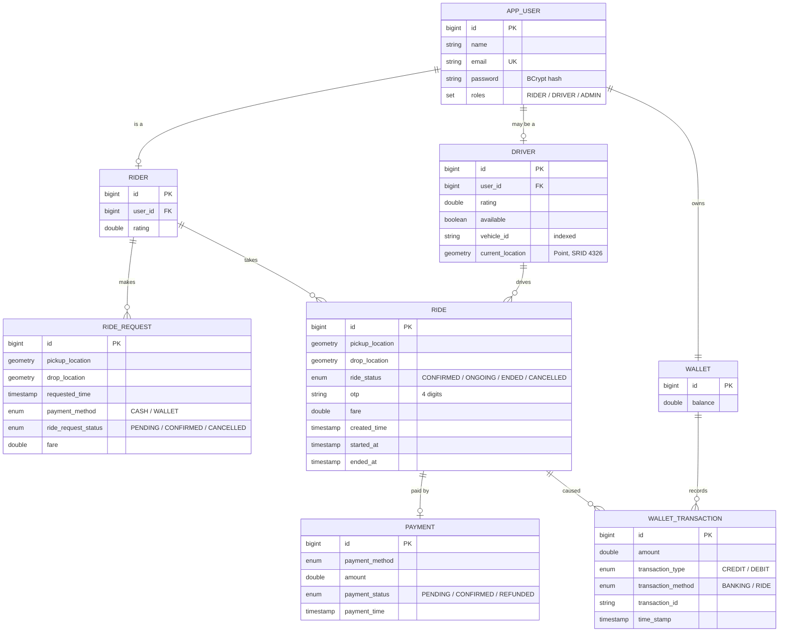

# Uber Ride-Booking Backend

A ride-hailing backend modelled on Uber, built with **Spring Boot 3.4 (Java 21)**, **PostgreSQL + PostGIS** and
**Spring Security with JWT**. Riders request rides, nearby drivers are matched using geospatial queries, fares are
calculated from real road distance, drivers start rides with an OTP, and payment is settled through an in-app wallet
or cash — with the platform taking a commission.

The core of the design is the **Strategy pattern**: driver matching, fare calculation and payment are each an
interface with interchangeable implementations, picked at runtime by a small "strategy manager".

> For a file-by-file explanation of the code, read **[docs/CODE_WALKTHROUGH.md](docs/CODE_WALKTHROUGH.md)**.

---

## Table of contents

1. [Features](#features)
2. [Tech stack](#tech-stack)
3. [Architecture](#architecture)
4. [The ride lifecycle](#the-ride-lifecycle)
5. [Design patterns used](#design-patterns-used)
6. [Data model](#data-model)
7. [API reference](#api-reference)
8. [Running locally](#running-locally)
9. [Configuration](#configuration)
10. [Deployment (AWS CodeBuild)](#deployment-aws-codebuild)
11. [Project structure](#project-structure)
12. [Known limitations and next steps](#known-limitations-and-next-steps)

---

## Features

| Area | What it does |
|---|---|
| **Authentication** | Sign-up, login, JWT access token (10 min) + refresh token (≈6 months, in an HTTP-only cookie), BCrypt password hashing |
| **Roles** | `RIDER`, `DRIVER`, `ADMIN`. Every new user is a rider; an admin onboards a user as a driver. Endpoints are protected with `@Secured` |
| **Ride request** | Rider sends pickup and drop coordinates; the fare is calculated and the request is stored as `PENDING` |
| **Driver matching** | PostGIS finds up to 10 available drivers near the pickup point — either the *nearest* ones or the *highest-rated* ones |
| **Fare calculation** | Real driving distance from the public **OSRM** routing API × ₹10/km, doubled during surge hours (6 pm – 9 pm) |
| **Ride lifecycle** | Driver accepts → ride `CONFIRMED` with a 4-digit OTP → driver starts with OTP (`ONGOING`) → driver ends (`ENDED`). Either side can cancel a confirmed ride |
| **Payments** | On ride end: **Wallet** (rider debited, driver credited minus 30 % commission) or **Cash** (driver collected cash, so the 30 % commission is debited from the driver's wallet) |
| **Wallet ledger** | Every credit/debit is recorded as a `WalletTransaction` linked to the ride |
| **Ride history** | Paginated, newest-first ride history for riders and drivers |
| **Uniform responses** | Every response is wrapped as `{ timestamp, data, error }`; errors are mapped to proper HTTP statuses in one place |
| **Email** | `EmailSenderService` sends plain-text email through Gmail SMTP (used in tests; ready for notifications) |
| **Ops** | Spring Boot Actuator, springdoc OpenAPI, dev/prod profiles, AWS CodeBuild `buildspec.yml` |

---

## Tech stack

| Layer | Technology |
|---|---|
| Language / framework | Java 21, Spring Boot 3.4.1 (Web, Data JPA, Security, Mail, Actuator) |
| Database | PostgreSQL with the **PostGIS** extension |
| Geospatial | Hibernate Spatial + JTS (`org.locationtech.jts.geom.Point`), SRID 4326 (WGS-84 latitude/longitude) |
| Routing / distance | [OSRM](https://project-osrm.org/) public API, called with Spring's `RestClient` |
| Auth | Spring Security, JJWT (HMAC-SHA signed tokens), BCrypt |
| Mapping | ModelMapper (with custom `Point` ⇄ `PointDto` converters) |
| API docs | springdoc-openapi (Swagger UI) |
| Boilerplate | Lombok |
| Testing | Spring Boot Test, Testcontainers (PostgreSQL) dependency |
| CI/CD | AWS CodeBuild (`buildspec.yml`, Amazon Corretto 21) |

---

## Architecture

A classic layered Spring Boot application. Each layer only talks to the one below it.



Cross-cutting pieces:

- **`GlobalResponseHandler`** wraps every successful body in `ApiResponse<T>`.
- **`GlobalExceptionHandler`** turns exceptions into `ApiResponse` with an `ApiError` and the right status code.
- **`MapperConfig`** teaches ModelMapper how to convert GeoJSON-style `PointDto` to a JTS `Point` and back.

---

## The ride lifecycle



### State machines



A ride can only be cancelled while it is `CONFIRMED` (before it starts). Cancelling makes the driver available again.

---

## Design patterns used

### Strategy pattern (the heart of the project)

Three behaviours change depending on context, so each is an interface with several implementations:

| Strategy interface | Implementations | Chosen by | Rule |
|---|---|---|---|
| `DriverMatchingStrategy` | `DriverMatchingNearestDriverStrategy`, `DriverMatchingHighestRatedDriverStrategy` | `RideStrategyManager.driverMatchingStrategy(riderRating)` | Rider rating **≥ 4.8** → highest-rated drivers within 15 km; otherwise → nearest drivers within 10 km |
| `RideFareCalculationStrategy` | `RideFareDefaultFareCalculationStrategy`, `RideFareSurgePricingFareCalculationStrategy` | `RideStrategyManager.rideFareCalculationStrategy()` | Between **18:00 and 21:00** → surge (×2); otherwise default |
| `PaymentStrategy` | `WalletPaymentStrategy`, `CODPaymentStrategy` | `PaymentStrategyManager.paymentStrategy(method)` | `WALLET` → wallet strategy, `CASH` → cash-on-delivery strategy |

Why it matters: adding, say, a "female drivers only" matching rule or a UPI payment method means adding **one new
class** and one line in the manager — none of the ride or payment services change (Open/Closed principle).

### Other patterns and practices

- **Layered architecture** — controller → service interface → service implementation → repository.
- **Programming to interfaces** — every service is an interface (`RiderService`) with an `…Impl`; `DistanceService`
  has an OSRM implementation that could be swapped for Google Maps.
- **DTO pattern** — entities never leave the service layer directly; ModelMapper converts them to DTOs.
- **Builder pattern** — Lombok `@Builder` on `Driver`, `Rider`, `Payment`, `WalletTransaction`.
- **Global exception handling and response wrapping** with `@RestControllerAdvice`.
- **Stateless authentication** with a custom `OncePerRequestFilter`.

---

## Data model



Indexes are declared on the entities: `app_user.email`, `driver.vehicle_id`, `ride.rider_id`, `ride.driver_id` and
`ride_request.rider_id` — the columns used for login and for "my rides" look-ups.

---

## API reference

All responses are wrapped:

```json
{
  "timestamp": "10:42:13 28-12-25",
  "data": { "...": "the actual payload" },
  "error": null
}
```

and errors look like:

```json
{
  "timestamp": "10:42:13 28-12-25",
  "data": null,
  "error": { "httpStatus": "NOT_FOUND", "errorMessage": "Ride not found for rideId: 7" }
}
```

Locations use a GeoJSON-style object. **Coordinates are `[longitude, latitude]`** (x first, then y):

```json
{ "type": "Point", "coordinates": [77.1025, 28.7041] }
```

Protected endpoints need the header `Authorization: Bearer <accessToken>`.

### Auth — `/auth` (public)

| Method | Path | Body | Returns | Notes |
|---|---|---|---|---|
| POST | `/auth/signup` | `{ "name", "email", "password" }` | `UserDto` (201) | Creates the user with role `RIDER`, a `Rider` profile and an empty `Wallet` |
| POST | `/auth/login` | `{ "email", "password" }` | `{ "accessToken" }` | Also sets an HTTP-only cookie with the refresh token |
| POST | `/auth/refresh` | – (reads cookie) | `{ "accessToken" }` | Issues a new access token from the refresh token |
| POST | `/auth/onboardNewDriver/{userId}` | `{ "vehicleId" }` | `DriverDto` (201) | **Admin only.** Adds the `DRIVER` role and creates the driver profile |

### Rider — `/riders` (role `RIDER`)

| Method | Path | Body / params | Returns |
|---|---|---|---|
| POST | `/riders/requestRide` | `{ "pickupLocation", "dropLocation", "paymentMethod": "WALLET" \| "CASH" }` | `RideRequestDto` with calculated `fare` |
| POST | `/riders/cancelRide/{rideId}` | – | `RideDto` (status `CANCELLED`) |
| POST | `/riders/rateDriver` | `{ "rideId", "rating" }` | *(not implemented yet)* |
| GET | `/riders/getMyProfile` | – | `RiderDto` |
| GET | `/riders/getMyRides` | `?pageOffset=0&pageSize=10` | `Page<RideDto>`, newest first |

### Driver — `/drivers` (role `DRIVER`)

| Method | Path | Body / params | Returns |
|---|---|---|---|
| POST | `/drivers/acceptRide/{rideRequestId}` | – | `RideDto` (status `CONFIRMED`, includes OTP) |
| POST | `/drivers/startRide` | `{ "rideId", "otp" }` | `RideDto` (status `ONGOING`) |
| POST | `/drivers/endRide/{rideId}` | – | `RideDto` (status `ENDED`) — payment is processed |
| POST | `/drivers/cancelRide/{rideId}` | – | `RideDto` (status `CANCELLED`) |
| POST | `/drivers/rateDriver` | `{ "rideId", "rating" }` | *(rates the rider; not implemented yet)* |
| GET | `/drivers/getMyProfile` | – | `DriverDto` |
| GET | `/drivers/getMyRides` | `?pageOffset=0&pageSize=10` | `Page<RideDto>`, newest first |

### Example: a complete ride with curl

```bash
# 1. Sign up and log in as a rider
curl -X POST localhost:8080/auth/signup -H 'Content-Type: application/json' \
     -d '{"name":"Asha","email":"asha@example.com","password":"secret123"}'
RIDER=$(curl -s -X POST localhost:8080/auth/login -H 'Content-Type: application/json' \
     -d '{"email":"asha@example.com","password":"secret123"}' | jq -r .data.accessToken)

# 2. Request a ride (Connaught Place → India Gate, New Delhi)
curl -X POST localhost:8080/riders/requestRide -H "Authorization: Bearer $RIDER" \
     -H 'Content-Type: application/json' -d '{
       "pickupLocation": {"type":"Point","coordinates":[77.2167, 28.6315]},
       "dropLocation":   {"type":"Point","coordinates":[77.2295, 28.6129]},
       "paymentMethod":  "CASH"
     }'

# 3. As a driver (onboarded by an admin): accept, start with OTP, end
curl -X POST localhost:8080/drivers/acceptRide/1 -H "Authorization: Bearer $DRIVER"
curl -X POST localhost:8080/drivers/startRide -H "Authorization: Bearer $DRIVER" \
     -H 'Content-Type: application/json' -d '{"rideId":1,"otp":"4821"}'
curl -X POST localhost:8080/drivers/endRide/1 -H "Authorization: Bearer $DRIVER"
```

### Error → status mapping

| Exception | HTTP status |
|---|---|
| `ResourceNotFoundException` | 404 Not Found |
| `RuntimeConflictException` (e.g. email already registered) | 409 Conflict |
| `AuthenticationException`, `JwtException` (bad/expired token) | 401 Unauthorized |
| `AccessDeniedException` (wrong role) | 403 Forbidden |
| Any other exception | 409 Conflict (catch-all) |

---

## Running locally

### Prerequisites

- Java 21 and Maven (or use the bundled `./mvnw`)
- Docker (easiest way to get PostgreSQL **with PostGIS**)

### 1. Start PostgreSQL with PostGIS

The default profile expects the database on **port 5433**:

```bash
docker run -d --name uber-db -p 5433:5432 \
  -e POSTGRES_USER=postgres -e POSTGRES_PASSWORD=postgres -e POSTGRES_DB=postgres \
  postgis/postgis:16-3.4
```

The `postgis/postgis` image already has the PostGIS extension enabled, which Hibernate Spatial needs for the
`Geometry(Point,4326)` columns.

### 2. Configure secrets

Set the values in `src/main/resources/application.properties` (better: pass them as environment variables — see
[Configuration](#configuration)):

- `spring.datasource.password` — your database password
- `jwt.secretKey` — any random string of **at least 32 characters** (HMAC-SHA256 needs 256 bits)
- `spring.mail.username` / `spring.mail.password` — a Gmail address and an **App Password** (only needed for email)

### 3. Run

```bash
./mvnw spring-boot:run
```

The API starts on <http://localhost:8080>. Hibernate creates the tables on start-up (`ddl-auto=create`).

### 4. Create an admin and a driver

Sign-up always creates riders. To get an admin, sign up and then add the role in SQL:

```sql
INSERT INTO user_roles (user_id, roles)
SELECT id, 'ADMIN' FROM app_user WHERE email = 'you@example.com';
```

Log in as that admin and call `POST /auth/onboardNewDriver/{userId}` with `{ "vehicleId": "DL01AB1234" }`.
Then set the driver's location so matching can find them:

```sql
UPDATE driver SET current_location = ST_GeomFromText('POINT(77.2167 28.6315)', 4326) WHERE id = 1;
```

### Running the tests

```bash
./mvnw test
```

The current tests load the application context and send test emails, so they need the database and SMTP settings.

---

## Configuration

Two Spring profiles are provided:

| File | Used when | Database | Schema | Seed data |
|---|---|---|---|---|
| `application.properties` | default | `localhost:5433/postgres` | `create` (rebuilt on every start) | – |
| `application-prod.properties` | `--spring.profiles.active=prod` | `${DB_HOST_URL}:5432/${DB_NAME}` with `${DB_USERNAME}` | `create-drop` | `data.sql` (10 users, 4 drivers around north Delhi, 2 wallets) |

Recommended environment variables (Spring maps them automatically):

| Variable | Property |
|---|---|
| `SPRING_DATASOURCE_URL` | `spring.datasource.url` |
| `SPRING_DATASOURCE_USERNAME` / `SPRING_DATASOURCE_PASSWORD` | database credentials |
| `JWT_SECRETKEY` | `jwt.secretKey` |
| `SPRING_MAIL_USERNAME` / `SPRING_MAIL_PASSWORD` | Gmail SMTP credentials |

> **Never commit real passwords or keys.** Keep them in environment variables or a secrets manager
> (AWS Secrets Manager / Parameter Store when deploying on AWS).

---

## Deployment (AWS CodeBuild)

`buildspec.yml` tells AWS CodeBuild how to build the service:

1. **install** — use the Amazon Corretto 21 runtime.
2. **build** — `mvn package -DskipTests` produces the executable jar.
3. **artifacts** — `target/*.jar` is published (flattened with `discard-paths`).
4. **cache** — `~/.m2` is cached between builds so dependencies are not downloaded every time.

The jar can then be deployed to Elastic Beanstalk or EC2 with the `prod` profile and the `DB_*` variables set.

---

## Project structure

```
src/main/java/com/sahil/project/uber/uberApp
├── UberAppApplication.java          Spring Boot entry point
├── advices/                         ApiResponse/ApiError wrapper + global exception & response handlers
├── configs/                         ModelMapper (Point converters), PasswordEncoder, Security filter chain
├── controllers/                     AuthController, RiderController, DriverController
├── dto/                             Request/response objects (PointDto, RideDto, SignupDto, …)
├── entities/                        JPA entities (User, Rider, Driver, RideRequest, Ride, Payment, Wallet, …)
│   └── enums/                       Role, RideStatus, RideRequestStatus, PaymentMethod, PaymentStatus, …
├── exceptions/                      ResourceNotFoundException, RuntimeConflictException
├── repositories/                    Spring Data JPA repositories (incl. PostGIS native queries)
├── security/                        JWTService (create/parse tokens), JWTAuthFilter
├── services/                        Service interfaces (+ UserService as UserDetailsService)
│   └── implementations/             Service implementations, OSRM distance client, email sender
├── strategies/                      Strategy interfaces + RideStrategyManager, PaymentStrategyManager
│   └── impl/                        Nearest/HighestRated matching, Default/Surge fare, Wallet/COD payment
└── utils/GeometryUtil.java          Builds JTS Points with SRID 4326
src/main/resources
├── application.properties           Default (dev) config
├── application-prod.properties      Production profile
└── data.sql                         Seed data for the prod profile
buildspec.yml                        AWS CodeBuild instructions
```

---

## Known limitations and next steps

These are honest gaps in the current code — good candidates for the next iteration:

- **Driver notification** — matching drivers are found but not yet notified (`TODO` in `RiderServiceImpl`).
  Next step: push via WebSockets/FCM, or email using the existing `EmailSenderService`.
- **Ratings** — `rateDriver` / `rateRider` endpoints exist but return `null`; a `Rating` entity and running
  average are needed.
- **Refresh-token cookie name** — login stores the refresh token in a cookie named `token`, while `/auth/refresh`
  looks for `refreshToken`; the two names must match for refresh to work.
- **Distance units in PostGIS** — the columns are `geometry` in SRID 4326, so `ST_Distance`/`ST_DWithin` work in
  *degrees*, not metres; the `10000`/`15000` radius therefore does not restrict anything. Casting to `geography`
  (`ST_DWithin(d.current_location::geography, :pickup::geography, 10000)`) makes the radius real metres.
- **Concurrency** — two drivers could accept the same request at the same moment; an optimistic lock (`@Version`)
  on `RideRequest` would prevent double acceptance.
- **Wallet balance checks** — wallet debits do not yet check for sufficient balance.
- **OTP exposure** — the OTP is returned in `RideDto` to the driver as well; it should only be shown to the rider.
- **Driver location updates** — there is no endpoint yet for drivers to update `currentLocation`.
- **Tests** — add unit tests for the strategies and Testcontainers integration tests for the ride flow.
- **Swagger UI** — springdoc is included, but `/swagger-ui/**` and `/v3/api-docs/**` need to be added to the
  public routes in `WebSecurityConfig` to open without a token.
